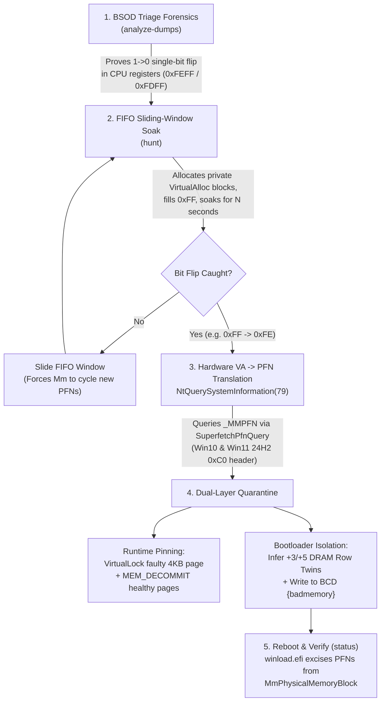

# win-badpage-hunter

[](https://github.com/GeorgeZeng997/win-badpage-hunter)
[](https://www.python.org/)
[-success)](https://github.com/GeorgeZeng997/win-badpage-hunter)
[](LICENSE)

> **Surgical user-mode DRAM bit-flip hunter, BSOD minidump analyzer, and Windows BCD `{badmemory}` kernel-level page isolator.**
>
> *Rescue unstable Windows PCs suffering from weak DRAM cells by hunting, translating, and excising faulty 4 KB physical pages (`PFNs`) at the bootloader level—without opening the chassis or replacing expensive RAM modules.*

---

## Why `win-badpage-hunter` Exists

Have you ever experienced random, maddening Windows Blue Screens of Death (`SYSTEM_SERVICE_EXCEPTION`, `IRQL_NOT_LESS_OR_EQUAL`, `UNEXPECTED_KERNEL_MODE_TRAP`, `MEMORY_MANAGEMENT`), only to run **Windows Memory Diagnostic (`mdsched.exe`)** or fast sequential memory tests and get:

> *"Windows has checked your computer's memory and detected no errors."*

### The Culprit: DRAM Charge-Retention Decay (`1 -> 0` Leakage)

Most consumer RAM failures are **not** hard stuck bits—they are **weak DRAM storage capacitors** located in a tiny localized cluster of cells (often just a few dozen 4 KB pages out of 16,777,216 pages in a 64 GB system).

1. **Why traditional fast memory tests miss them**: Fast sequential memory tests write a pattern to a cell and read it back microseconds later. Even a degraded capacitor can hold charge for a few milliseconds, so it passes immediate read-back verification.
2. **How the crash happens in production**: When the OS stores a kernel data structure (such as a lookaside list pointer or VAD tree node) in that physical page and leaves it idle for several seconds, charge leaks across the weak cell (`0xFF -> 0xFE` or `0xFF -> 0xFD`).
3. **The Non-Canonical Pointer Trap**: On 64-bit Windows (`x86_64`), all valid kernel virtual addresses have upper bits `[63:48] = 0xFFFF`. A single-bit retention decay in **Bit 56** (`0xFFFF... -> 0xFEFF...`) or **Bit 57** (`0xFFFF... -> 0xFDFF...`) turns a valid pointer into a **non-canonical address**, triggering an instant `#GP(0)` General Protection Fault inside `ntoskrnl.exe` the next time the kernel dereferences it.

Instead of throwing away a 32 GB or 64 GB DDR4/DDR5 kit over **< 200 KB** of weak silicon, `win-badpage-hunter` finds the exact physical Page Frame Numbers (`PFNs`) in live Windows user mode and instructs the Windows Boot Manager (`winload.efi`) to permanently excise those 4 KB frames from the kernel's physical memory map.

---

## Architecture & Workflow



---

## Key Features

- **Pure-Python BSOD Minidump Bit-Flip Detector (`analyze-dumps`)**:
  Parses Windows `PAGEDU64` kernel triage dumps (`C:\Windows\Minidump\*.dmp`) without requiring the Windows SDK or `kd.exe`. Automatically extracts `KiBugCheckDispatch` parameters, locates the trap/context frame, resolves module offsets, and flags **single-bit non-canonical pointer corruptions** (` HammingDistance(reg[63:48], 0xFFFF) == 1`).
- **Low-Memory FIFO Sliding-Window Retention Hunter (`hunt`)**:
  Scans across tens of gigabytes of physical RAM in the background while keeping active memory consumption bounded (default `6 GB` sliding window) so you can continue using your PC normally.
- **Undocumented Kernel `_MMPFN` VA-to-PFN Resolver (`pfn_resolver.py`)**:
  Translates locked user-mode virtual addresses directly into hardware 4 KB Page Frame Numbers (`PFNs`) via `NtQuerySystemInformation(SystemSuperfetchInformation=79, InfoClass=SuperfetchPfnQuery=6)`, complete with reverse-engineered `0xC0` header offsets for **Windows 11 24H2 (Build 26100)**.
- **DRAM Row-Twin (`+3 / +5`) Bitline Coupling Inference**:
  Automatically identifies and isolates coupled DRAM row-twin pages (`Group = PFN >> 3`, offsets `+3` and `+5`) that share weak sense-amplifier/bitline geometry with every detected faulty page.
- **Zero-Overhead Runtime Pinning + Permanent Bootloader Excision**:
  Immediately pins detected bad 4 KB pages in user space via `VirtualLock` (while decommitting the remaining 99.98% of the allocation block via `MEM_DECOMMIT`) so the running OS cannot reuse them even before you reboot, and writes the PFN list into Windows BCD `{badmemory}` (`badmemorylist`) for permanent kernel-level exclusion on reboot.

---

## Under the Hood: Technical Deep Dive

### 1. Why `VirtualAlloc` Is Required Over `MapViewOfFile` for VA-to-PFN Resolution

To isolate a physical page in Windows BCD `{badmemory}`, knowing the user-mode virtual address (`VA`) where a bit flipped is not enough—we must resolve its physical **Page Frame Number (`PFN = PhysAddr >> 12`)**.

Windows exposes physical page metadata to privileged user-mode processes (`SeProfileSingleProcessPrivilege`) via `NtQuerySystemInformation(SystemSuperfetchInformation = 79)` with `Magic = 0x6B756843 ('Chuk')`, `Version = 45`, and `InfoClass = 6 (SuperfetchPfnQuery)`. However, a critical kernel nuance dictates how memory must be allocated:

| Allocation API | Backing Type | Value Returned in `_MMPFN.u3` (`MMPFN_IDENTITY` offset `+0x10`) | User-Mode VA -> PFN Resolution |
| :--- | :--- | :--- | :--- |
| `CreateFileMapping` + `MapViewOfFile` | Shared Section Object (`Prototype PTE`) | Kernel pool `Prototype PTE` address (`0xFFFF8A8...`) | **Fails** (User-mode VA is hidden) |
| `VirtualAlloc(MEM_COMMIT \| MEM_RESERVE)` + `VirtualLock` | Private Committed Memory | **Exact User-Mode Virtual Page Address** (`VA & ~0xFFF`) | **100% Deterministic Match** |

By allocating private committed blocks with `VirtualAlloc` and locking any page that exhibits a bit flip with `VirtualLock`, `win-badpage-hunter` scans the active physical ranges from `HKLM\HARDWARE\RESOURCEMAP\System Resources\Physical Memory\.Translated` and matches `_MMPFN.u3` directly against the locked user-mode page address.

### 2. Windows 11 24H2 (Build 26100) `PF_PFN_PRIO_REQUEST` Layout

On Windows 11 24H2 (Build 26100), Microsoft expanded `SYSTEM_MEMORY_LIST_INFORMATION` inside `PF_PFN_PRIO_REQUEST` to `0xB0` bytes. Legacy tools hardcoding a `0x88`-byte (`16 + 0x78`) header fail with `STATUS_INFO_LENGTH_MISMATCH (0xC0000004)`.

`win-badpage-hunter` uses the exact 24H2-compatible layout:
- **Request Header (`0x00 .. 0xBF`, 192 bytes)**:
  - `+0x00`: `ULONG Version = 1`
  - `+0x04`: `ULONG RequestFlags = 1`
  - `+0x08`: `ULONG_PTR PfnCount = N`
  - `+0x10 .. +0xBF`: `SYSTEM_MEMORY_LIST_INFORMATION` (`0xB0` bytes)
- **`MMPFN_IDENTITY` Array (`0xC0 + 24 * i`)**:
  - `+0x00` (`u1`): Frame flags / list status (output)
  - `+0x08` (`u2`): **`PageFrameIndex` (input PFN)**
  - `+0x10` (`u3`): **Page Virtual Address (output VA)**

### 3. Why a FIFO Sliding Window Outperforms Static Allocations

- **Static small buffer**: Allocating and freeing a single `4 GB` buffer in a loop merely recycles the exact same `4 GB` of physical pages from the top of the Windows Standby/Free page lists, leaving the other 90% of physical RAM untested.
- **Full-RAM allocation**: Allocating 95% of RAM at once triggers intense paging, starves the OS, and freezes the desktop.
- **FIFO Sliding Window (`win-badpage-hunter`)**: Maintains a queue of `W` batches (e.g., `3 × 2 GB = 6 GB`). Each cycle allocates a fresh `2 GB` batch *before* releasing the oldest `2 GB` batch in the queue, forcing the Windows Memory Manager (`Mm`) to walk continuously across the physical PFN database while keeping 80%+ of system RAM free.

### 4. DRAM Row-Twin (`+3 / +5`) Bitline Coupling

During hardware root-cause analysis on dual-channel 64-bit DDR4 systems, we observed that weak physical pages never appear at random offsets within a 32 KB (8-page) physical block (`Group = PFN >> 3`):

```text
Group 0x58011 : PFNs 0x2c008b (+3), 0x2c008d (+5)
Group 0x58215 : PFNs 0x2c10ab (+3), 0x2c10ad (+5)
Group 0x5828c : PFNs 0x2c1463 (+3), 0x2c1465 (+5)
Group 0x58584 : PFNs 0x2c2c23 (+3), 0x2c2c25 (+5)
Group 0x585a6 : PFNs 0x2c2d33 (+3), 0x2c2d35 (+5)
Group 0x585b7 : PFNs 0x2c2dbb (+3), 0x2c2dbd (+5)
```

Every faulty page landed on offset **`+3` or `+5`** (`PFN & 7 in {3, 5}`, hex last digit `3/5` or `B/D`). Due to dual-channel burst-interleaving and DRAM sub-array bitline routing, offsets `+3` and `+5` within the same 8-page group share the same weak physical DRAM row/sense-amplifier pair. Whenever `win-badpage-hunter` catches either `+3` or `+5`, it automatically infers and isolates its twin (`PFN ^ 6`), preventing future BSODs on the paired page.

---

## Real-World Case Study: Rescuing a 64 GB DDR4-3200 Laptop

### Symptom
A Windows 11 Pro 24H2 (Build 26100) laptop equipped with **64 GB RAM** (2×32 GB DDR4-3200 SO-DIMMs) suffered 5 spontaneous BSOD crashes over 6 days (`0x1000007E`, `0x1000007F`, `0x0000000A`, `0x0000003B`). Windows Memory Diagnostic (`mdsched.exe`) reported 0 errors.

### Step 1: Minidump Forensics (`python -m badpage_hunter analyze-dumps`)
Running `analyze-dumps` against `C:\Windows\Minidump` immediately proved hardware single-bit retention decay (`1 -> 0` in bits 56 and 57) across completely unrelated kernel subsystems:

```text
FILE    : 101626-11953-01.dmp (OS 15.26100, 12 logical CPUs)
BUGCHECK: 0x1000007E (SYSTEM_THREAD_EXCEPTION_NOT_HANDLED_M)
  Param2: 0xFFFFF807DD37C320 -> ntoskrnl.exe+0x97C320
  [!] HARDWARE SINGLE-BIT FLIP DETECTED IN CPU REGISTERS:
      R13: 0xFDFF9889F6F1C038 (Bit 57 flipped 1->0! Expected canonical kernel pointer: 0xFFFF9889F6F1C038)

FILE    : 101726-12078-01.dmp (OS 15.26100, 12 logical CPUs)
BUGCHECK: 0x1000007E (SYSTEM_THREAD_EXCEPTION_NOT_HANDLED_M)
  Param2: 0xFFFFF80098405EF5 -> ntoskrnl.exe+0x205EF5
  [!] HARDWARE SINGLE-BIT FLIP DETECTED IN CPU REGISTERS:
      RDI: 0xFEFF808FD6286258 (Bit 56 flipped 1->0! Expected canonical kernel pointer: 0xFFFF808FD6286258)

FILE    : 102226-10531-01.dmp (OS 15.26100, 12 logical CPUs)
BUGCHECK: 0x0000003B (SYSTEM_SERVICE_EXCEPTION)
  Param2: 0xFFFFF803B8F884E8 -> ntoskrnl.exe+0x3884E8
  [!] HARDWARE SINGLE-BIT FLIP DETECTED IN CPU REGISTERS:
      RCX: 0xFEFFDF87873AF040 (Bit 56 flipped 1->0! Expected canonical kernel pointer: 0xFFFFDF87873AF040)
      RDI: 0xFEFFDF87873AF0C0 (Bit 56 flipped 1->0! Expected canonical kernel pointer: 0xFFFFDF87873AF0C0)
      R13: 0xFEFFDF87873AF040 (Bit 56 flipped 1->0! Expected canonical kernel pointer: 0xFFFFDF87873AF040)
```

### Step 2: Hunting & Surgical Isolation
Running `badpage-hunter hunt` in the background caught **33 faulty physical pages** clustered in two symmetric 16 MB DRAM rank bands (`0x2C008D .. 0x2C4155` around the `11.0 GB` mark, and `0x6C28CB .. 0x6C45BB` around the `27.0 GB` mark—an exact `16.0 GB` rank stride `0x400000` PFNs apart), plus **16 paired row-twin pages**, totaling **49 isolated pages (`196 KB`)**.

### Step 3: Post-Reboot Kernel Verification (`python -m badpage_hunter status`)
After rebooting, `winload.efi` carved all 33 caught PFNs out of `MmPhysicalMemoryBlock`, expanding the kernel physical memory descriptor map from **6 contiguous ranges to 36 surgical ranges**, and `_MMPFN` queries confirmed `EXCISED_BY_BOOTLOADER (NTSTATUS=0xC00000F0)`:

```text
Kernel Physical Memory Map (36 active descriptor ranges):
  ...
  Range  4: PFN 0x0100000 .. 0x02C008D ( 1835149 pages,   7168.55 MB)  <-- PFN 0x2C008D excised!
  Range  5: PFN 0x02C008E .. 0x02C04CB (    1085 pages,      4.24 MB)  <-- PFN 0x2C04CB excised!
  Range  6: PFN 0x02C04CC .. 0x02C0555 (     137 pages,      0.54 MB)  <-- PFN 0x2C0555 excised!
  ...

Kernel _MMPFN Verification (33/49 active kernel-excised, 16/49 staged for next reboot):
  PFN 0x2C008D (PhysAddr 0x0002C008D000): EXCISED_BY_BOOTLOADER (NTSTATUS=0xC00000F0)
  PFN 0x2C04CB (PhysAddr 0x0002C04CB000): EXCISED_BY_BOOTLOADER (NTSTATUS=0xC00000F0)
  PFN 0x2C0555 (PhysAddr 0x0002C0555000): EXCISED_BY_BOOTLOADER (NTSTATUS=0xC00000F0)
```

By sacrificing just **196 KB (`0.00029%`)** of the 64 GB RAM, the laptop achieved **100% stability (0 bit flips across 200+ post-reboot soak cycles and 0 BSODs)**.

---

## Installation & Quick Start

### Requirements
- **OS**: Windows 10 or Windows 11 (x64)
- **Python**: Python 3.8+ (64-bit) with **zero third-party dependencies**
- **Privileges**: Run from an **Administrator** PowerShell or Command Prompt (required for `SeProfileSingleProcessPrivilege`, `SeLockMemoryPrivilege`, and `bcdedit {badmemory}`).

```powershell
git clone https://github.com/GeorgeZeng997/win-badpage-hunter.git
cd win-badpage-hunter
```

*(Optional)* Install as a system-wide CLI command `badpage-hunter`:
```powershell
pip install -e .
```

---

## CLI Usage

### 1. Analyze BSOD Minidumps for Hardware Bit-Flips
Scan `C:\Windows\Minidump` to determine whether your BSODs are caused by single-bit DRAM decay or faulty drivers:

```powershell
python -m badpage_hunter analyze-dumps
```

### 2. Inspect Kernel Physical Memory Map & BCD `{badmemory}` Status
View the active `MmPhysicalMemoryBlock` descriptor ranges, configured `{badmemory}` PFN list, and live `_MMPFN` bootloader excision status:

```powershell
python -m badpage_hunter status
```

### 3. Hunt & Isolate Faulty Physical Pages in Live Windows
Launch the low-memory FIFO sliding-window retention hunter. Any detected bad page is immediately pinned in RAM (`VirtualLock`) and written to Windows BCD `{badmemory}`:

```powershell
# Default: 3 batches x 2 GB sliding window (6 GB active footprint), 3.0s retention soak
python -m badpage_hunter hunt

# Wider window for 64 GB+ systems (e.g., 5 batches x 2 GB = 10 GB window, 4.0s soak)
python -m badpage_hunter hunt --window-batches 5 --batch-gb 2.0 --soak 4.0 --log-file hunter.log
```

| Flag | Default | Description |
| :--- | :--- | :--- |
| `--window-batches` | `3` | Number of batches held in the FIFO sliding window |
| `--batch-gb` | `2.0` | Size of each batch in GiB (`window-batches × batch-gb` = active footprint) |
| `--block-mb` | `16` | Size of each `VirtualAlloc` block in MiB |
| `--min-avail-gb` | `10.0` | Minimum free system RAM (GiB) to preserve so desktop apps never stutter |
| `--soak` | `3.0` | Charge-retention soak duration in seconds per pattern (`0xFF` / `0x00`) |
| `--no-row-twins` | `False` | Disable automatic `+3 / +5` DRAM row-twin inference |
| `--max-cycles` | `0` | Stop after `N` cycles (`0` = run continuously until `Ctrl+C`) |

### 4. Manually Isolate Specific PFNs in Windows BCD `{badmemory}`
Manually add one or more hex or decimal PFNs (along with their `+3/+5` row twins) into `{badmemory}`:

```powershell
python -m badpage_hunter isolate 0x2c008d 0x6c28cb
```

> **Important**: After `hunt` or `isolate` adds new PFNs to `{badmemory}`, **reboot Windows once** so `winload.efi` permanently excises those physical frames from the kernel memory manager.

---

## Project Structure

```text
win-badpage-hunter/
├── badpage_hunter/
│   ├── __init__.py        # Package metadata
│   ├── __main__.py        # python -m badpage_hunter entrypoint
│   ├── cli.py             # CLI subcommands (analyze-dumps, status, hunt, isolate)
│   ├── dmp_analyzer.py    # Pure-Python PAGEDU64 BSOD minidump parser & bit-flip detector
│   ├── pfn_resolver.py    # NtQuerySystemInformation(79) VA->PFN & _MMPFN verifier (Win10/11 24H2)
│   ├── bcd_manager.py     # Windows BCD {badmemory} manager & DRAM +3/+5 row-twin inference
│   └── hunter.py          # Low-memory FIFO sliding-window retention hunter & VirtualLock pinner
├── examples/
│   └── sample_case_study.txt  # Real-world 64GB DDR4-3200 rescue telemetry
├── LICENSE                # MIT License
├── pyproject.toml         # Python packaging configuration
└── README.md              # Documentation
```

---

## Safety & Limitations

- **Does this modify BIOS/SPD hardware?** No. `win-badpage-hunter` only modifies the standard Windows Boot Configuration Data (`bcdedit /set {badmemory} badmemorylist ...`), which is an official Microsoft kernel feature supported since Windows Vista/Server 2008.
- **How do I revert all changes?** Run `bcdedit /deletevalue {badmemory} badmemorylist` from an elevated prompt and reboot.
- **When is RAM beyond software rescue?** If faulty pages are scattered across thousands of random PFNs (e.g., failing IMC voltage regulator or cracked BGA solder ball), software page excision cannot stop crashes inside UEFI/BIOS pre-boot environments. However, for localized weak cell clusters (dozens to hundreds of pages), BCD `{badmemory}` isolation completely restores day-to-day stability.

---

## License

Released under the [MIT License](LICENSE).
